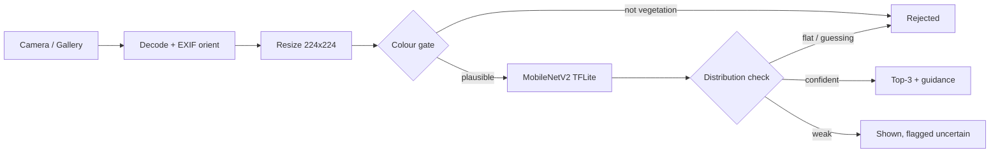

# PDDS — Plant Disease Detection System

Offline plant disease detection for Android and iOS. Photograph a single leaf and a
convolutional neural network identifies the condition **entirely on-device** — no
internet connection, no server, and no image ever leaves the phone.


---

## Screenshots

<!-- Screenshots are not in the repository yet. To show them:
     1. Put home.png, result.png, about.png and rejected.png in docs/screenshots/
     2. Remove the comment markers around the table below.

| Home | Diagnosis | Coverage | Rejected input |
|:---:|:---:|:---:|:---:|
|  |  |  |  |
-->

Screenshots will be added here.

---

## Overview

PDDS pairs a MobileNetV2 classifier trained on the PlantVillage dataset with a
Flutter application that runs the model locally through TensorFlow Lite. It is
built for use in the field, where connectivity is often unavailable and a
round-trip to a server is not an option.

The model distinguishes **38 conditions across 14 crop species**, covering both
diseased and healthy states.

### Why on-device

| | Server-based | PDDS (on-device) |
|---|---|---|
| Connectivity | Required | Not required |
| Latency | Network round-trip | ~30–80 ms |
| Privacy | Images uploaded | Images never leave the phone |
| Running cost | Per-request | None |

---

## Features

- **Offline inference** — the full model ships inside the app (~5 MB, float16 quantized)
- **38 disease classes** across 14 crops, with a healthy state for each
- **Top-3 predictions** with confidence scores and an animated confidence gauge
- **Treatment guidance** — symptoms, treatment and prevention for each condition
- **Non-plant rejection** — refuses to diagnose photos that are not plant material
- **Confidence gating** — low-confidence results are flagged rather than presented as fact
- **EXIF-aware capture** — camera and gallery images classify identically
- **Background preprocessing** — pixel work runs in an isolate, so the UI never blocks
- **Searchable coverage list** — generated from the model's own labels, never hardcoded

---

## How it works



1. The image is decoded, rotated upright from its EXIF data, and resized to 224 × 224.
2. A colour gate measures vegetation content before the model is consulted.
3. Raw 0–255 pixel values go to the model as a `[1, 224, 224, 3]` tensor.
4. The softmax output is checked for confidence and entropy.
5. The top three classes are shown, with agronomic guidance for the leading result.

---

## Tech stack

**Machine learning**

| Component | Role |
|---|---|
| TensorFlow / Keras | Model definition, training, export |
| MobileNetV2 | CNN backbone, ImageNet pretrained |
| Transfer learning | Frozen backbone, then fine-tuning |
| scikit-learn | Stratified split, classification report, confusion matrix |
| Pandas | Dataset inventory and class-balance analysis |
| Matplotlib | Distribution plots, training curves, confusion matrix |
| TensorFlow Lite | Float16 quantization for mobile |
| Google Colab | GPU training (NVIDIA T4) |

**Mobile application**

| Component | Role |
|---|---|
| Flutter | Cross-platform UI framework |
| Dart | Application language |
| `tflite_flutter` | On-device inference via FFI |
| `image` | Decoding, EXIF orientation, resizing |
| `image_picker` | Camera and gallery capture |
| Material 3 | Design system foundation |

---

## Dataset

**PlantVillage** — Mendeley Data / Penn State University, open access for research.

| | |
|---|---|
| Total images | 54,303 |
| Classes | 38 |
| Crop species | 14 |
| Images used per class | capped at 600 |
| Train / validation split | 80 / 20, stratified |

Leaf photographs captured under controlled lighting against plain backgrounds,
each labelled with its crop species and either a specific disease or a healthy
status.

**Crops covered:** Apple, Blueberry, Cherry, Corn (maize), Grape, Orange, Peach,
Bell Pepper, Potato, Raspberry, Soybean, Squash, Strawberry, Tomato.

---

## Model and training

MobileNetV2 with ImageNet weights, trained in two phases:

| Phase | Backbone | Learning rate | Purpose |
|---|---|---|---|
| 1 | Frozen | 1e-3 | Train the new classifier head |
| 2 | Top 40 layers unfrozen | 1e-5 | Adapt features to leaf imagery |

Augmentation (random flip, rotation, zoom, contrast) is applied in the `tf.data`
pipeline rather than inside the model. This is deliberate: Keras `Random*` layers
compile to ops the TFLite converter cannot translate, so keeping them out of the
graph is what makes the export succeed.

`preprocess_input` **is** inside the graph, so the mobile app sends raw 0–255
pixel values and performs no normalization of its own.

### Results

| Metric | Value |
|---|---|
| Validation accuracy | _fill in from your run_ |
| Model size (float16) | ~5 MB |
| Inference time | ~30–80 ms |

> Section 12 of the notebook prints the accuracy and a per-class breakdown.
> Section 15 verifies the exported TFLite model still matches the Keras model.

---

## Handling non-plant images

A softmax classifier is **closed-set**: its outputs are forced to sum to 1, so it
can never return "none of these". Shown a photo of a cat, it would still name a
disease. PDDS layers three checks around the model:

| Layer | Method | Catches |
|---|---|---|
| 1 | Colour gate — hue band + Excess Green index | Faces, fur, vehicles, sky, interiors |
| 2 | Softmax entropy, top probability, top-1/top-2 margin | Unfamiliar subjects producing flat distributions |
| 3 | *(optional)* trained `Not_a_plant` class | Green non-plant objects |

Layers 1 and 2 are active by default. Layer 3 requires retraining and is
documented in [`PDDS/NOT_A_PLANT_TRAINING.md`](PDDS/NOT_A_PLANT_TRAINING.md); the app
detects such a class automatically with no code changes.

---

## Project structure

```
pdds/
├── ml/
│   └── Plant_Disease_Detection_Colab.ipynb   # full training pipeline
├── lib/
│   ├── main.dart
│   ├── data/
│   │   ├── app_info.dart              # app, developer and dataset constants
│   │   └── disease_library.dart       # symptoms / treatment / prevention
│   ├── models/
│   │   └── prediction.dart            # Prediction, ScanResult, verdicts
│   ├── services/
│   │   ├── classifier_service.dart    # TFLite loading and inference
│   │   └── image_stats.dart           # vegetation and uncertainty measures
│   ├── screens/
│   │   ├── home_screen.dart
│   │   ├── result_screen.dart
│   │   ├── rejected_screen.dart
│   │   ├── about_screen.dart
│   │   └── developer_screen.dart
│   ├── theme/
│   │   └── app_theme.dart             # colours, typography, spacing
│   └── widgets/
│       ├── app_widgets.dart
│       └── confidence_ring.dart
├── assets/
│   ├── models/                        # .tflite + labels.txt go here
│   ├── icon/
│   └── images/
└── pubspec.yaml
```

---

## Getting started

### 1. Train the model

Open `ml/Plant_Disease_Detection_Colab.ipynb` in Google Colab.

1. **Runtime → Change runtime type → T4 GPU**
2. **Runtime → Run all**

The dataset downloads automatically — no Kaggle account required. Training takes
roughly 25–35 minutes. The final cell downloads `flutter_model_assets.zip`
containing `plant_disease_model.tflite` and `labels.txt`.

### 2. Set up the app

```bash
git clone https://github.com/<your-username>/pdds.git
cd pdds
flutter pub get
```

Unzip the model files into `assets/models/`:

```
assets/models/plant_disease_model.tflite
assets/models/labels.txt
```

### 3. Android configuration

In `android/app/build.gradle`, inside the `android { }` block:

```gradle
defaultConfig {
    minSdkVersion 21
}

// Gradle compresses assets by default, which corrupts the .tflite file.
androidResources {
    noCompress 'tflite'
}
```

### 4. iOS configuration

In `ios/Runner/Info.plist`:

```xml
<key>NSCameraUsageDescription</key>
<string>Take photos of plant leaves to detect disease.</string>
<key>NSPhotoLibraryUsageDescription</key>
<string>Select plant photos from your library to detect disease.</string>
```

### 5. Run

```bash
flutter run --release
```

Use `--release` when measuring speed; debug builds run inference several times slower.

---

## The ML ↔ app contract

These five properties must agree on both sides. If predictions look wrong, one of
them has drifted.

| # | Property | Value | Set in notebook | Read in app |
|---|---|---|---|---|
| 1 | Input size | 224 | `IMG_SIZE` | `ClassifierService.inputSize` |
| 2 | Input range | raw 0–255 | `preprocess_input` inside graph | no scaling in Dart |
| 3 | Input shape | `[1,224,224,3]` | model definition | `reshape(...)` |
| 4 | Output | `[1,n]` softmax | `Dense(activation='softmax')` | ranked scores |
| 5 | Label order | alphabetical | `labels.txt` from `class_names` | read line by line |

`ClassifierService.load()` throws a descriptive error at startup if the model and
`labels.txt` disagree on class count, so a mismatched pair fails loudly instead of
silently predicting nonsense.

---

## Troubleshooting

| Symptom | Cause | Fix |
|---|---|---|
| `UnmodifiableUint8ListView isn't defined` | `tflite_flutter` 0.10.x on Dart 3.4+ | Use `tflite_flutter: ^0.12.1` |
| `Inconsistent JVM-target compatibility` | Kotlin defaults to JVM 21, plugin pins Java 11 | Add `kotlin.jvm.target.validation.mode=IGNORE` to `android/gradle.properties` |
| `Unable to load asset ... .tflite` | Asset not declared | Check `pubspec.yaml`, then `flutter clean` |
| Loads on iOS, fails on Android | Gradle compressed the model | Add `noCompress 'tflite'` |
| Every prediction similar and low | Double normalization | Do not divide pixels by 255 in Dart |
| Confident but always wrong class | Label order mismatch | Re-export `.tflite` and `labels.txt` together |
| Camera and gallery disagree | EXIF rotation | Keep `img.bakeOrientation()` |
| Slow inference | Debug build | Run with `--release` |

---

## Limitations

- Recognises only the 14 crops listed above; an unlisted plant yields an unreliable result.
- Training images used plain backgrounds, so cluttered field photos are less reliable.
- Cannot judge severity, or separate disease from nutrient deficiency or physical damage.
- A green non-plant object can still pass the colour gate — see Layer 3 above.
- **Not a substitute for professional advice.** Confirm with a qualified agronomist
  before applying any chemical treatment.

---

## Roadmap

- [ ] Trained `Not_a_plant` reject class
- [ ] Persistent scan history (`sqflite`)
- [ ] Live camera inference with `IsolateInterpreter`
- [ ] Multi-language interface (Dari, Pashto)
- [ ] Severity estimation from lesion area
- [ ] Offline treatment lookup expanded beyond the current library

---

## Author

**Fazlurrahman Hotaki**
Software Engineering Graduate & Developer — Ghalib University, Herat, Afghanistan

📧 fazlurrahmanhotaki512@gmail.com

---

## Acknowledgements

- **PlantVillage** — Hughes, D.P. & Salathé, M. (2015). *An open access repository
  of images on plant health.* [arXiv:1511.08060](https://arxiv.org/abs/1511.08060)
- **MobileNetV2** — Sandler et al. (2018). *Inverted Residuals and Linear
  Bottlenecks.* [arXiv:1801.04381](https://arxiv.org/abs/1801.04381)
- TensorFlow, Flutter and the `tflite_flutter` maintainers.

---

## License

Released under the MIT License. See [`LICENSE`](LICENSE).

The PlantVillage dataset carries its own terms; review them before any commercial use.
